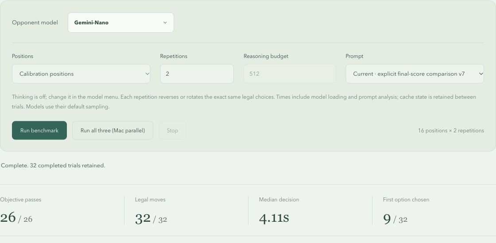

# Shared prompt v7: Nano failure clarification

The v6 Nano miss was a real final-score quality loss: pit 6 preserves a forced
25–23 win, while pit 5 can force 30–18. The accepted move and every benchmark,
rules and solver file are unchanged from the baseline commit; their hashes are
in `observed-summary.json`.

## Prompt change

Both old action cards described their conditional continuation as an “optimal
AI turn.” This could sound like a global recommendation even on the inferior
card. The inspected Nano response chose that inferior label; no reasoning was
returned, so the wording explanation is a hypothesis rather than an observed
internal thought.

V7 calls the continuation conditional, presents an order-preserving comparison
of the verified final stores, and marks the weaker finish as giving up five AI
seeds and ten points of final margin. All numbers come from the unchanged
terminal solver. All legal action labels remain in the model's output schema.
There is no benchmark-case or model-specific decision shortcut.

## Measured results

Same `mancala-tactics-v3` cases, shared-v7 prompt, thinking off, model/browser
default sampling and paired forward/reversed orders. Runs were serial.

| Model                          | Calibration objectives | Calibration legal | Holdout objectives/legal |
| ------------------------------ | ---------------------- | ----------------- | ------------------------ |
| Gemini-Nano, Chrome Prompt API | 26/26                  | 32/32             | 6/6                      |
| LFM3-1.7B-GGUF                 | 26/26                  | 32/32             | 6/6                      |

Nano also passed the original failing case **6/6** times over three rotated,
forward/reversed choice pairs. Both models passed the two steal regressions in
both orders. These repeats are separate from the calibration denominator.
The earlier Nano v6 baseline remains 25/26; it was not retroactively regraded.

These are 82 completed trials on a small tactical suite. They do not establish
full-game strength or guarantee every future generation. Holdout positions were
unchanged and were not used to tune the wording.

## Evidence

`observed-summary.json` records every trial. Three compressed full reports were
read from the visible DOM and written directly to temporary/project files:
Nano calibration 32, Nano rotated repeats 6, and LFM3 holdouts 6. All 44 embedded
system and position prompts were rebuilt from their boards/orders and compared
exactly with the preserved source version. LFM3 calibration 32 and Nano holdouts 6
were retained as native-accessibility observations; no full raw transcript is
claimed for those two runs. No browser download was used.

Nano is the adapter's Chrome label; no exact native model version was inspected.
The long-lived preview's reported revision is preserved in the raw reports;
source text was verified separately rather than relabeling an old revision.

Timing is observational and uncontrolled: Nano's calibration median was 4.11s,
its holdout median 0.88s and its repeated case median 1.05s. LFM3 medians were 0.53s
and 0.55s. Cache, readiness and runtime conditions vary; these runs do not prove
a causal prompt-related latency regression or speed improvement.

