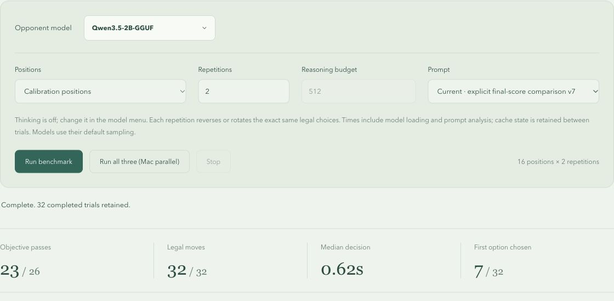

# Qwen GGUF: shared-v7 Mancala benchmark

Model: `unsloth/Qwen3.5-2B-GGUF`, selected as Qwen3.5-2B-GGUF in the local
Chrome app. Same `shared-v7` prompt and `mancala-tactics-v3` positions as the
Nano/LFM3 comparison. Thinking off, model-default sampling, two repetitions
with paired forward/reversed legal-action order. No parallel run was started.

| Metric                              | Result       |
| ----------------------------------- | ------------ |
| Calibration objectives              | 23/26        |
| Calibration legal choices           | 32/32        |
| Holdout objectives/legal            | 6/6          |
| Steal-defense regressions           | 3/4          |
| Median observed calibration/holdout | 0.62s /0.64s |

LFM3 and Nano both scored 26/26 calibration objectives and 6/6 holdouts on the
same shared-v7 suite in the preceding recorded runs. This is a small tactical
comparison, not a general playing-strength ranking. Timing includes analysis,
loading/cache effects and uncontrolled runtime conditions.

## Retained calibration misses

- `safe-capture-over-exposure`, repetition 1: chose AI pit 5 instead of pit 1.
  The supplied legal Human witness (pits 3 then 5) can capture 12 seeds, including
  eleven stolen from the AI stash. Pit1 takes the safe eleven-seed capture.
- `large-capture`, repetition 2: chose AI pit 6 instead of pit 2, missing the
  supplied five-seed capture. This is a miss against the declared complete-reply
  objective; no claim of a solved full-game outcome is made for this position.
- `save-the-draw`, repetition 1: chose AI pit 3 instead of one of pits 1, 4, 6.
  A separate full-terminal audit gives the selected move margin −4 (AI 22,
  Human 26), while the accepted actions draw 24–24. This is a losing choice
  rather than merely a preference for a smaller winning margin.

All 38 measured choices were legal. The model returned no reasoning text with
thinking off. No failed trial was retried or replaced, and no prompt or grading
change was made for this run.

## Evidence

`calibration.json.gz` and `holdout.json.gz` are the full displayed JSON reports,
read from the visible report DOM and written directly to temporary/project
files. `summary.json` contains settings, exact answers, chosen orders, grading,
misses and the independent draw audit. Every embedded system and position
prompt was rebuilt from its board/order/version: 38/38 matched exactly.

The preview's original reported revision is retained rather than relabeled.
The source commit and prompt-text verification are recorded separately. No
browser download control was used and no file was written to Downloads.

