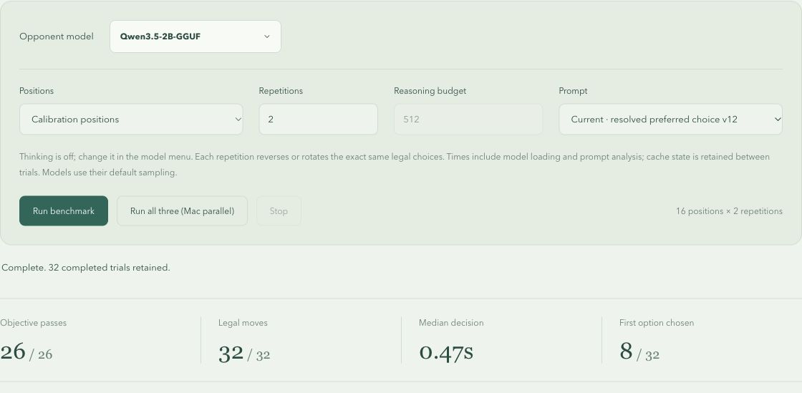

# Qwen failure review and shared-v12 prompt refinement

All runs used local Chrome and `mancala-tactics-v3`. Calibration has 16 boards
(13 scored, three ungraded diagnostics); holdouts have three scored boards.
Default comparisons use two repetitions with paired reversed action order,
thinking **off**, and model-default sampling. Qwen is
`unsloth/Qwen3.5-2B-GGUF`; LFM3 is `LiquidAI/LFM3-1.7B-GGUF`; Nano is Chrome's
`prompt-api` opponent (browser-selected model, no native model version asserted).
Runs were serial. Every generated choice, including misses, is retained.

## Were the original failures genuine?

Yes. An independent C++ implementation matched the TypeScript rules on 18,851
transitions from 100 deterministic games. The terminal-margin search was also
cross-checked against unpruned memoized search on 100 small reachable endgames.
`mancala_qwen_judgment_2026-11-03.json` records methods, bounds, nodes and hashes;
the two standalone C++ sources are preserved here and are not production code.

- **Safe capture:** pit 1 forces an AI win; selected pit 5 forces a Human win.
  This is an exact win/draw/loss proof with terminal or secured-majority cutoffs,
  not an exact final-score claim for the 39-seed board. The selected-root proof
  visited 100,854,722 nodes. The legal Human bonus/steal witness captures 12 seeds,
  including eleven from the AI stash.
- **Large capture:** pit 2 gives the best final margin, AI 23–25, versus selected
  pit 6's 21–27. Every legal action loses under perfect play, but Qwen surrendered
  two extra AI seeds. These are exact terminal margins without majority cutoffs.
- **Save the draw:** accepted pits 1, 4 and 6 draw 24–24. Selected pit 3 loses 22–26.

No accepted move or grading objective was relaxed. The rules, production search,
endgame solver, AI response validation, benchmark cases, independent references,
audit and runner are byte-identical to baseline `4bddb3e`; see
`unchanged-source.json`. Frozen v7 is also byte-identical to that commit's prompt.

## Reasoning-guided changes

Two native thinking diagnostics per original miss used a 2,048-token budget on
v7. All six passed, but the traces were used for wording ideas, not included in
the default-mode score. They showed confusion about instructions versus report
data, treating all schema-legal actions as preferred, and overvaluing zero capture
exposure despite a proved defeat. A trace is evidence of what the model wrote,
not a causal proof of why its separate thinking-off generation failed.

V12 uses a concise, AI-relative outcome table. Proved defeats and draws have
explicit labels. One final `RECOMMENDED AI ACTION` resolves the already computed
preferred group; ties use its first action, except an immediately terminal draw
is preferred when all preferred actions are proved draws. This is prompt guidance:
every legal action stays selectable, no model answer is rewritten, and no extra
search, benchmark-specific board lookup or sampling change is introduced.
Incomplete analysis cannot create a recommendation.

## Experiments retained

| Prompt/run | Qwen calibration objectives | Note |
| --- | --- | --- |
| v7 baseline | 23/26 | Original run in adjacent `qwen-gguf-2026-11-03` archive |
| v8 | 22/26 | Data-only structured JSON regressed |
| v9 | 25/26 | Concise table; one draw mistake remained |
| v10 | 25/26 | Explicit proved defeat/draw; same remaining miss |
| v11 | 18/26 | Semantic capture/bonus labels regressed; not current |
| **v12** | **26/26** | Explicit resolved recommendation |

The v10 draw-only diagnostic passed 4/4 despite the full-run miss, showing why
an isolated retry was insufficient. A v9 LFM3 regression run passed 26/26 and is
retained separately. No failed full run was replaced by these diagnostics.

## Final v12 regression

| Model, thinking off | Calibration | Holdouts | Legal choices | Median calibration / holdout |
| --- | --- | --- | --- | --- |
| Qwen GGUF | 26/26 | 6/6 | 38/38 | 0.47s / 0.48s |
| LFM3 GGUF | 26/26 | 6/6 | 38/38 | 0.42s / 0.41s |
| Chrome Nano Prompt API | 26/26 | 6/6 | 38/38 | 0.71s / 0.71s |

Qwen's three original failure boards each also passed four rotated/reversed
repetitions, **12/12 total**, thinking off. Calibration, holdout and stress runs
are separate reports. Timing includes analysis, model loading/cache effects and
uncontrolled runtime conditions; it is not a controlled model speed comparison.
These are tactical checks, not evidence of general playing strength or Elo.
Qwen retains vendor nonthinking defaults (temperature 1, top-k 20, top-p 1,
presence penalty 2); repeated perfect scores are not a guarantee of future output.

## Evidence and validation

All 18 full JSON reports were read from the visible report DOM and written
directly to task/project paths, without clicking Download or using Downloads.
`summary.json` lists each report, model settings, scores and misses. All **296**
recorded system prompts, position prompts and legal choices were rebuilt from
their recorded board/order/version and matched exactly. Reproduce with:

```sh
node --experimental-strip-types apps/mancala/bench/fixtures/qwen-refinement-2026-11-03/verify-reports.mjs
```

The preview's originally reported source revision is preserved rather than
relabeled; exact prompt verification supplies provenance for the later working
changes. Versions v1–v12 remain selectable for reproducibility. Source checks:
107 tests, typecheck, lint, independent benchmark audit and static production
build passed. Automated tests do not invoke models.


